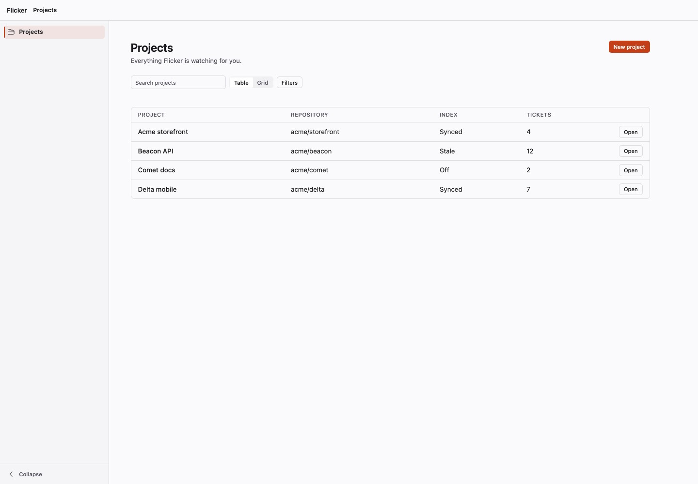
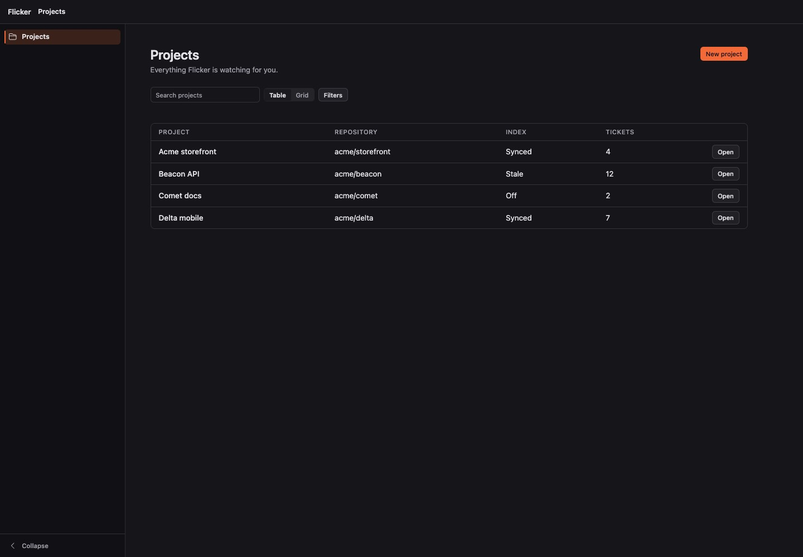
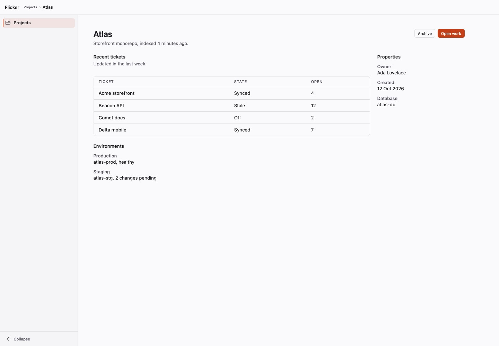
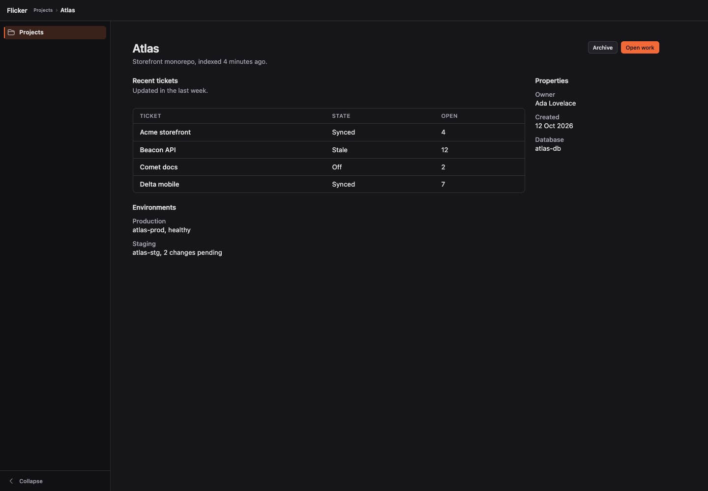
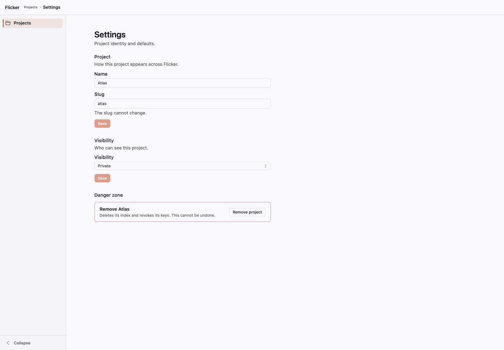
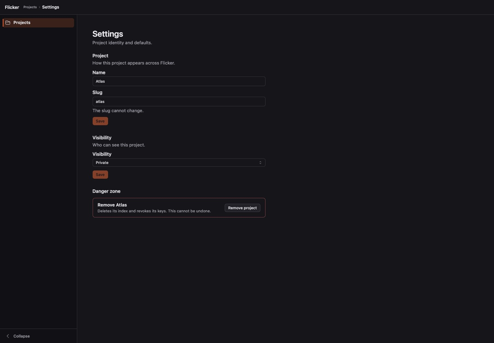
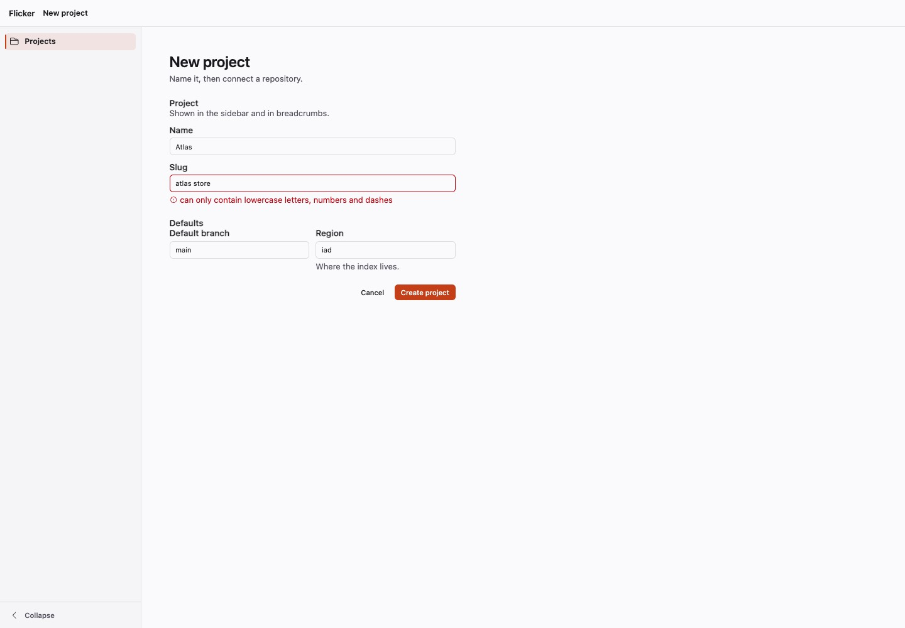
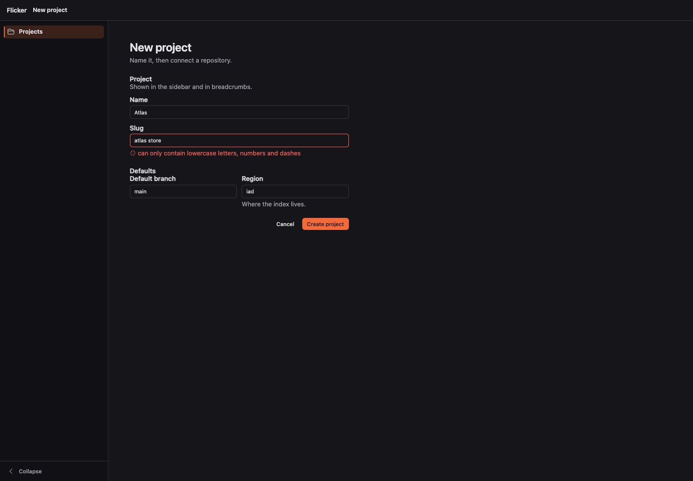
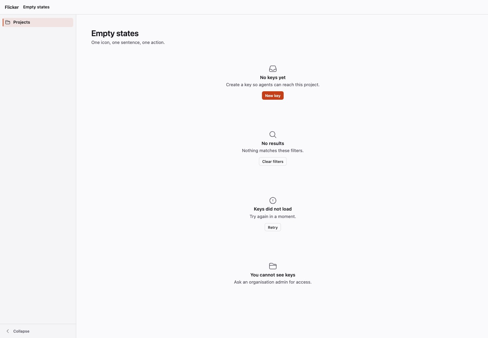
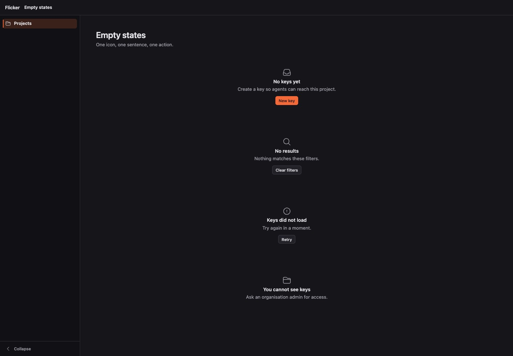

# Page recipes

Five shared page recipes for the shadcn app preset (`Theme.theme preset="shadcn-app"`): **index**, **detail**,
**settings**, **form** and **empty**. Shadcn is the inspiration for proportions and rhythm, not a port. Applications
consume these; they do not re-create page geometry with page CSS.

One owner per decision: the shell owns chrome, **these recipes own width, gutters and section spacing**, the table owns
row geometry. Every recipe sits inside `<.page_shell layout="bare">` (the breadcrumb lives in the single app bar) and
starts with `<.page_container>`. The fixture that renders all five is `test/qa/recipe_pages_live.ex`; the gate is
`test/qa/recipe_pages.mjs`.

| Piece | Does |
|---|---|
| `page_container` | left-aligned, named width (`narrow` 36rem, `default` 80rem, `wide` ~91rem, `full`), 1.5rem / 1.75rem gutters. Tokens `--lui-page-w-*` |
| `page_heading` | body `h2` (24px in the preset), one-line lead, primary action right |
| `page_section` | small heading, one description line, content |
| `index_toolbar` | search, view toggle, filters, then actions pushed right |
| `detail_layout` | main column plus optional sticky right rail |
| `settings_page layout="stacked"` + `settings_form` | stacked sections, ONE dirty-aware Save per form |
| `form_group`, `form_actions`, `.lui-form-stack` | grouped fields, one gap, one action row |
| `empty_state kind=…` | icon, one sentence, one action |

## 1. Index

**When:** a list of records. Title and the one primary action live in the heading; the toolbar is only what the job
needs (search, view toggle, filters). Do not add bulk selection or a grid toggle to a simple table.

```heex
<.page_shell id="projects" layout="bare" title="Projects">
  <.page_container>
    <.page_heading title="Projects" lead="Everything Flicker is watching for you.">
      <:actions><.button size="sm" variant="solid">New project</.button></:actions>
    </.page_heading>
    <.index_toolbar>
      <:search><.input id="q" name="q" type="search" size="sm" placeholder="Search projects" /></:search>
      <:filters><.button size="sm" variant="outline">Filters</.button></:filters>
    </.index_toolbar>

    <.skeleton :if={@loading?} label="Loading projects" style="height: 10rem" />
    <.empty_state :if={@empty? and not @loading?} kind="first_use" title="No projects yet">
      Connect a repository and Flicker starts indexing it.
      <:action><.button size="sm" variant="solid">New project</.button></:action>
    </.empty_state>
    <.empty_state :if={@no_match?} kind="no_match" title="No projects match">
      Nothing matches these filters.
      <:action><.button size="sm" variant="outline" phx-click="clear_filters">Clear filters</.button></:action>
    </.empty_state>
    <.data_table :if={@rows != []} id="projects-table" rows={@rows} meta={@meta} path={~p"/projects"} …>
      <:col :let={row} field={:name} label="Project">{row.name}</:col>
    </.data_table>
  </.page_container>
</.page_shell>
```

Empty is four states, not one: first use (create), no match (clear filters), load failure (retry) and permission-limited
(no action). Pinned/section bands are `data_table` bands, not group headers (see the table-bands docs).

## 2. Detail

**When:** one selected record. Title and actions once, sibling sections, an optional properties rail. Domain content
(pricing matrices, topology) stays in the app.

```heex
<.page_container>
  <.page_heading title={@project.name} lead="Storefront monorepo, indexed 4 minutes ago.">
    <:actions><.button size="sm" variant="solid">Open work</.button></:actions>
  </.page_heading>
  <.detail_layout>
    <.page_section id="recent" title="Recent tickets" description="Updated in the last week.">
      <.data_table …/>
    </.page_section>
    <:rail>
      <.page_section id="props" title="Properties">
        <.description_list columns={1}>
          <:item label="Owner">Ada Lovelace</:item>
        </.description_list>
      </.page_section>
    </:rail>
  </.detail_layout>
</.page_container>
```

The rail stacks under the main column below 64rem.

## 3. Settings

**When:** preferences and configuration. Rules: a left-aligned container lined up with the heading; sections stacked,
each a heading, one description line and its fields at the 36rem measure; **one Save per form**, disabled until the
form is dirty, never a Save beside one field; the danger zone last; **no tabs** for about four small sections.
Add `<:nav>` (a vertical section list) only for genuinely separate, large areas.

```heex
<.page_container>
  <.settings_page layout="stacked" title="Settings" subtitle="Project identity and defaults.">
    <.settings_form for={@form} dirty={@dirty} title="Project" description="How it appears across Flicker."
      phx-change="validate" phx-submit="save">
      <.input field={@form[:name]} label="Name" size="sm" />
    </.settings_form>
    <.danger_zone>
      <.danger_zone_item title="Remove Atlas" description="Deletes its index and revokes its keys.">
        <:action><.button size="sm" variant="outline" color="danger">Remove project</.button></:action>
      </.danger_zone_item>
    </.danger_zone>
  </.settings_page>
</.page_container>
```

`dirty` is server-owned: in `handle_event("validate", …)` compare the submitted params to the saved record. The
prototype's leave-with-unsaved-changes confirmation is app behaviour (it needs a modal and a router hook) and is not in
the recipe. Errors are short human sentences; raw exception text never reaches a section.

## 4. Form

**When:** create or edit one record. Field spacing (label, control, help, error) belongs to `input`; `form_group` owns
the gap between fields and the legend; `form_actions` is cancel (ghost) then the one primary submit, right-aligned.

```heex
<.page_container width="narrow">
  <.page_heading title="New project" lead="Name it, then connect a repository." />
  <.form for={@form} phx-change="validate" phx-submit="save" class="lui-form-stack">
    <.form_group legend="Project" description="Shown in the sidebar and in breadcrumbs.">
      <.input field={@form[:name]} label="Name" size="sm" />
    </.form_group>
    <.form_group legend="Defaults" columns={2}>…</.form_group>
    <.form_actions>
      <.button size="sm" variant="ghost" type="button">Cancel</.button>
      <.button size="sm" variant="solid" type="submit">Create project</.button>
    </.form_actions>
  </.form>
</.page_container>
```

Validation is inline: `input` shows its errors under the control once the field has been used.

## 5. Empty / zero state

```heex
<.empty_state kind="first_use" title="No keys yet">
  Create a key so agents can reach this project.
  <:action><.button size="sm" variant="solid">New key</.button></:action>
</.empty_state>
```

`kind` is `first_use`, `no_match`, `error` (announced as an alert) or `restricted`. One icon (defaulted by kind), one
sentence, at most one action.

## Gate

`node test/qa/recipe_pages.mjs` (header lists the command) renders every recipe and state at 1440 and 375, light and
dark, and asserts: no horizontal overflow, heading and content share the container's left edge, container within its
named max, table rows <= 44px, non-primary controls <= 32px, settings forms each have exactly one Save that is
disabled until dirty and no tabs, settings panel <= 36rem, and each empty state has an icon, a title and at most one
action. `QA_RECIPE_SHOTS=dir` also writes the screenshots.

## Screenshots (1440, light | dark)

**index**

 

**detail**

 

**settings**

 

**form**

 

**empty**

 

