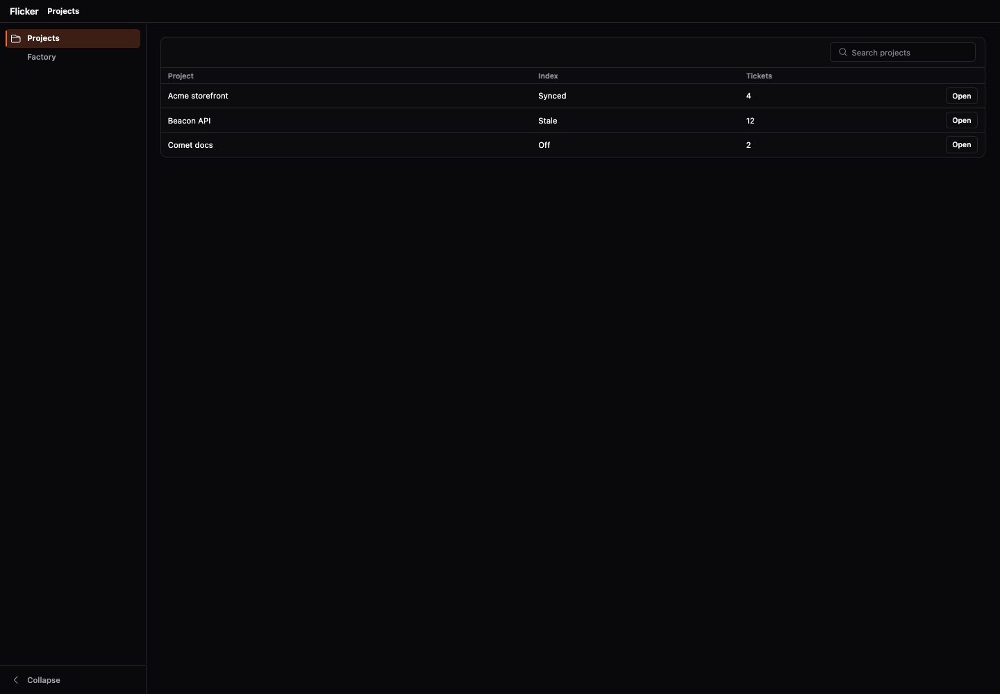
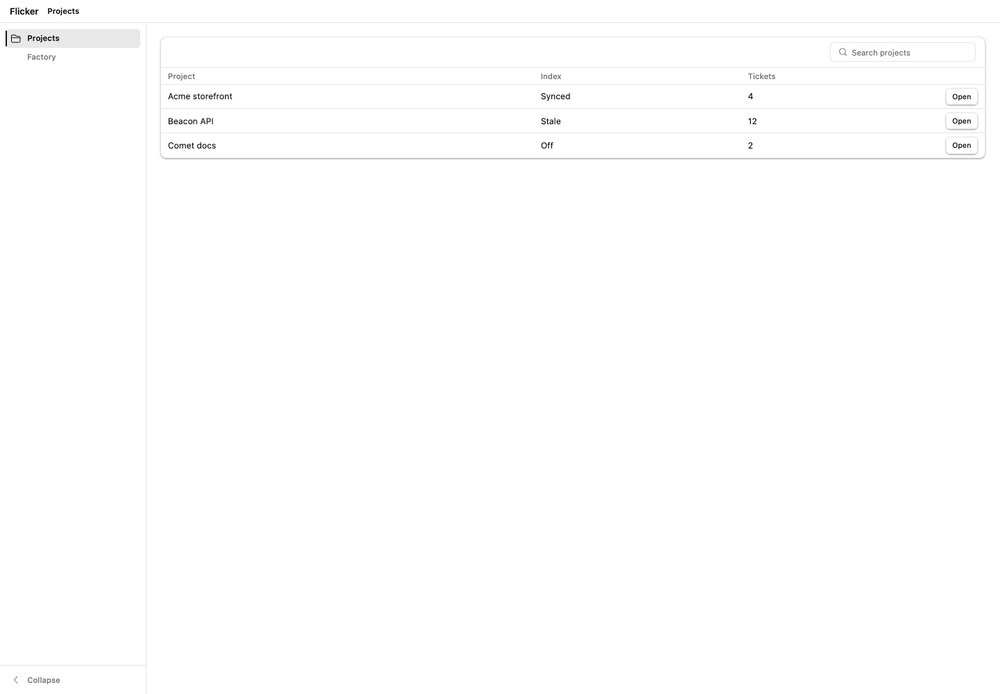
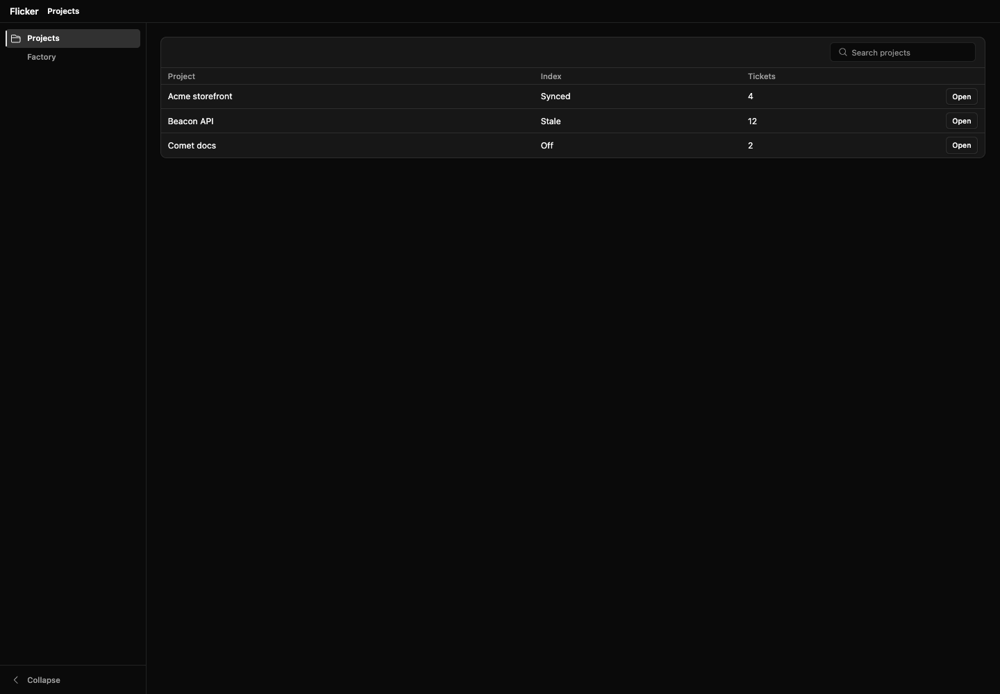
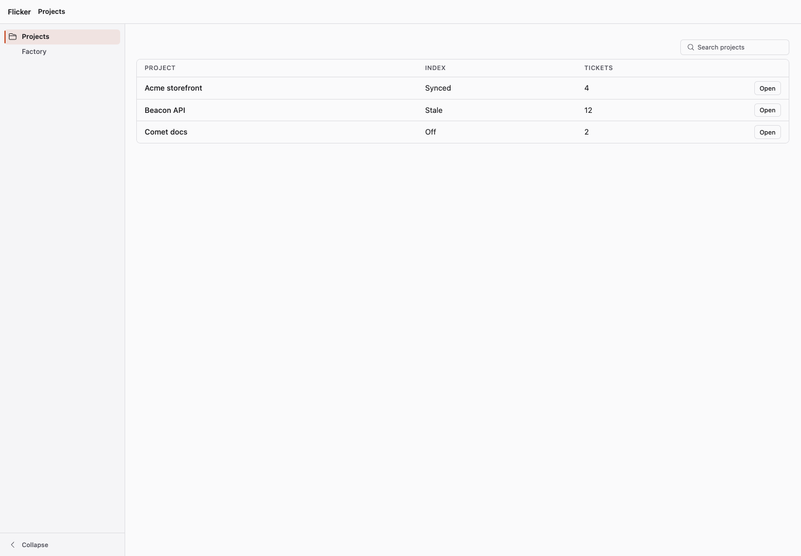
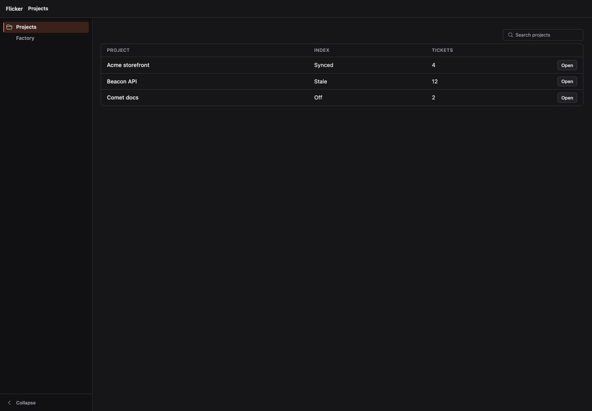
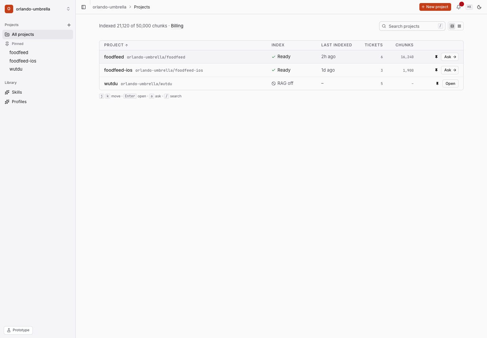

# shadcn `app` preset

Makes lantern components reproduce a dense, warm-accent shadcn app (the Flicker prototype) with
**tokens and component default CSS only**: no forked components, no scoped class system.

```heex
<Theme.theme preset="shadcn-app" />
<%!-- or by hand, on <html> or any subtree: --%>
<html data-lantern-theme="shadcn" data-lantern-preset="app" class="dark?">
```

Import `lantern_ui_preset_app.css` (after `lantern_ui.css`; it does not need `lantern_ui_theme.css`).
The host ships the `@font-face` for `Inter Variable` and `Space Grotesk Variable`; the stack falls back to
`system-ui`. Dark mode follows the `.dark` class.

## Values (the spec: measured from the prototype at 1440px)

All sizes are rem on a **14px root** (the preset sets `font-size: 14px` on the element carrying it, so on
`<html>` the whole app follows; Flicker already runs a 14px root). Px below are the computed results.

| Role | Value | Token |
|---|---|---|
| UI font / heading font | Inter Variable / Space Grotesk Variable | `--lantern-font`, `--lantern-font-brand` |
| Table cell text | 13.5px / 20.25px | `--lui-table-font`, `--lui-table-leading` |
| Small text, state | 13px | `--lantern-text-sm` |
| Nav / section heading / xs control | 12.25px / 15px / 11.2px | `--lantern-text-nav`, `--lantern-text-heading`, `--lantern-text-xs` |
| Surfaces | page oklch(.985 .002 286) < card (1 0 0) < raised | `--background`, `--card`, `--popover` |
| Accent | light oklch(.556 .176 36) + white; dark oklch(.685 .182 39) + ink | `--primary` |
| Radius | table card 7px, small controls 5.6px | `--radius`, `--lui-control-radius` |
| Table | no shadow, transparent card, cell 14/7 → row ~39.5px | `--lui-table-shadow`, `--lui-table-bg`, `--lui-table-cell-px/py` |
| Shell | sidebar 224px, bar 42px | `--lui-sidebar-expanded-w`, `--lui-topline-h` |
| Buttons | xs 24px, sm 28px, md 32px; outline = page bg + border (dark: input/30) | `--lui-control-h-xs/sm/md` |

## Single-topbar shell

`<.app_shell compact>` with the `<.breadcrumb>` in the `:header` slot and `<.page_shell layout="bare">`:
one bar, no second breadcrumb row.

## Gate

`node test/qa/shadcn_preset.mjs` (see its header) measures the fixture at `/shadcn_preset` against the table
above, light and dark; `test/lantern_ui/shadcn_preset_test.exs` also fails on literal text sizes in component markup.

## Side by side

| | light | dark |
|---|---|---|
| default |  |  |
| `shadcn` |  |  |
| `shadcn-app` |  |  |
| prototype |  | |

## Needs markup change (not reachable by style)

- **Row padding on the row**: the prototype pads `<li role=row>` (14/7) and its cells 0; lantern pads `<td>`
  (14/7). Same geometry, different element. Smallest change: none needed.
- **Inline index/state**, row-level pin button and `Ask →` split actions are consumer slots, not preset values.
- **Mono secondary text** (`org/repo` beside the name) is cell content; use `--lantern-font-mono`.
